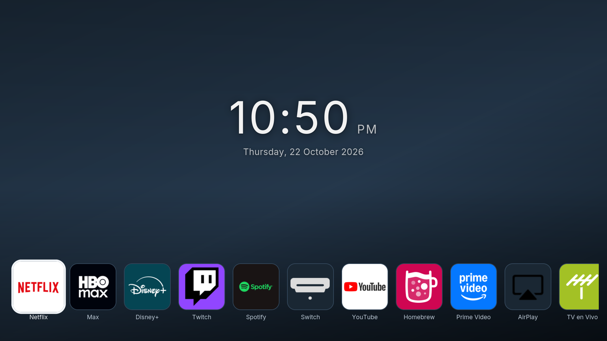

# lg-webos4-tweaks

Más RAM libre, un mando reprogramable y un botón HOME que abre lo que tú
quieras, en **televisores LG de 2018 rooteados (webOS 4.x)**.

🇬🇧 [Read this in English](README.md)



<sub>Un 43UK6300PSB con una pantalla de inicio propia en lugar de la barra de
LG. Captura nativa a través del inspector del propio televisor, no una foto.</sub>

---

Los LG de 2018 traen unos 840 MB de RAM y dedican buena parte a mantener
Netflix, el navegador y otras apps precargadas en segundo plano, las uses o no.
El resultado es un televisor que tira de swap, va a tirones y tarda una
eternidad en abrir cualquier cosa.

Medido en un **43UK6300PSB** (webOS 4.4.3-22, firmware 05.50.70):

| | Antes | Después |
|---|---|---|
| RAM disponible | 183 MB | **373 MB** |
| Swap en uso | 197 MB | 0 MB |
| Apps precargadas | 9 | 0 |
| Botones del mando | Netflix / Prime Video, fijos | la app que quieras |
| Botón HOME | la barra de LG | la app que quieras |

Casi todos los proyectos de este tipo apuntan a 2019 en adelante.
[LGlow](https://github.com/IrvingGuerra/lglow), que sería la opción obvia,
excluye explícitamente 2018 porque reemplaza el inicio a pantalla completa
(`com.webos.app.fullhome`) que llegó con webOS 4.5 — los de 2018 no lo tienen.
Este repositorio es lo que queda al asumir eso, y resultó ser la parte que de
verdad importa.

## Compatibilidad

**Probado en:** LG 43UK6300PSB, webOS 4.4.3-22 (`goldilocks-gorongosa`),
firmware 05.50.70, plataforma `lm18a` / `HE_DTV_W18A`.

**Debería funcionar** en la línea webOS 4.x de 2018, que es la que tiene
`/usr/lib/qt5/qml/KeyFilters/appLaunch.js` y una barra de iconos en vez de un
inicio a pantalla completa. Cada parche comprueba el archivo que va a
reemplazar y se niega si no cuadra, así que una incompatibilidad no hace nada:
no rompe el televisor.

**No soportado:** 2019 en adelante (webOS 4.5+). La parte de la RAM podría
funcionar igual, pero los parches de teclas asumen esta disposición exacta del
compositor.

> **La numeración de firmware no es comparable entre años.** LGlow pide
> "05.40.09 o superior", que es de la rama 2019. Este televisor lleva 05.50.70,
> un número mayor de la rama 2018. No son equiparables.

## Versiones

| Componente | Versión usada | Notas |
|---|---|---|
| Homebrew Channel | 0.7.3 | imprescindible |
| dejavuln-autoroot | 0.0.10 | para rootear; por USB, sin modo desarrollador |
| Este repositorio | ver historial de git | aún sin versiones publicadas |

## Requisitos

- Un LG de 2018 (webOS 4.x), **rooteado**, con Homebrew Channel instalado.
- Acceso SSH al televisor, activado en los ajustes de Homebrew Channel.

¿Aún sin rootear? Consulta antes [cani.rootmy.tv](https://cani.rootmy.tv/) con
tu modelo y firmware. Si todavía es rooteable,
[dejavuln-autoroot](https://github.com/throwaway96/dejavuln-autoroot) funciona
desde una memoria USB, sin modo desarrollador ni cuenta de LG.

> **Desactiva las actualizaciones automáticas antes que nada.** Cuando LG le
> mande a tu televisor un firmware parcheado, rootearlo se acabó para siempre.
> En Homebrew Channel, activa además **Block system updates**. Eso solo
> redirige `su.lge.com` y `snu.lge.com`; la LG Content Store sigue funcionando.

> **No instales nunca la app Modo Desarrollador de LG** en un televisor
> rooteado: elimina el root en el siguiente reinicio.

## Descarga

```sh
git clone https://github.com/josearevalo19977722-dev/lg-webos4-tweaks
cd lg-webos4-tweaks
```

O descarga el ZIP desde el botón verde **Code** de GitHub y descomprímelo. No
hay nada que compilar: el instalador es un script de shell.

## Instalación

El instalador se ejecuta **en el televisor**, enviado por SSH. No copia ni deja
nada en tu ordenador.

```sh
# Solo la RAM — el primer paso más seguro
ssh root@<IP-DEL-TV> 'sh -s' < install.sh
```

```sh
# Todo: liberar RAM, reasignar los dos botones y el HOME, registrar una
# entrada de TV y abrir tu launcher en cada encendido
ssh root@<IP-DEL-TV> 'NETFLIX_BUTTON=youtube.leanback.v4 \
                      AMAZON_BUTTON=com.disney.disneyplus-prod \
                      HOME_APP=mi.launcher \
                      TV_INPUT=mi.launcher \
                      BOOT_APP=mi.launcher sh -s' < install.sh
```

Después **reinicia el televisor**. Los parches solo surten efecto desde un
arranque.

### Opciones

| Variable | Efecto |
|---|---|
| `NETFLIX_BUTTON=<appId>` | el botón Netflix abre esta app |
| `AMAZON_BUTTON=<appId>` | el botón Amazon abre esta app |
| `HOME_APP=<appId>` | el botón HOME abre esta app en vez de la barra de LG |
| `TV_INPUT=<appId>` | registra la app como entrada, junto a HDMI 1/2/3 |
| `BOOT_APP=<appId>` | abre esta app en cada encendido |
| `STOP_AIRPLAY=0` | mantiene AirPlay y HomeKit |
| `SKIP_PRELOAD=1` | no toca la precarga de apps |

Para ver los identificadores de tus apps:

```sh
ssh root@<IP-DEL-TV> 'luna-send -n 1 -f luna://com.webos.applicationManager/listApps "{}" </dev/null'
```

> `TV_INPUT` exige que el `appinfo.json` de la app declare
> `"supportGIP": true`. Sin eso, `addDevice` responde `returnValue: true` y la
> entrada no aparece nunca.

## Comprobar que funcionó

Después de reiniciar:

```sh
# montajes en su sitio: 5 de precarga, 1 o 2 de teclas
ssh root@<IP-DEL-TV> 'mount | grep -c preloadmanager; mount | grep -c KeyFilters'

# el compositor se reinició DESPUÉS de montar los parches (así que los leyó):
# esto debe imprimir un número mayor que ~45
ssh root@<IP-DEL-TV> 'sm=$(pgrep -x surface-manager); \
  echo $(( $(awk "{print \$22}" /proc/$sm/stat) / $(getconf CLK_TCK) ))s'

# memoria libre
ssh root@<IP-DEL-TV> 'free -m'
```

Cada script deja su propio registro:

```
/var/lib/webosbrew/free-ram.log
/var/lib/webosbrew/keys.log
/var/lib/webosbrew/tv-input.log
/var/lib/webosbrew/boot-app.log
```

## Desinstalación

```sh
ssh root@<IP-DEL-TV> 'sh -s' < uninstall.sh
```

Reinicias y vuelve a estar de fábrica. **No se modifica ningún archivo de las
particiones de LG**: las copias parcheadas viven en `/var/lib/webosbrew` y se
montan encima en cada arranque, así que borrar los scripts y reiniciar revierte
todo.

Si usaste `TV_INPUT`, quita también la entrada desde el propio televisor.

## Qué se instala

```
/var/lib/webosbrew/
├── init.d/10-free-ram              precarga off, AirPlay/HomeKit detenidos
├── init.d/20-keys                  monta los parches y reinicia el compositor
├── init.d/30-tv-input              registra la app como entrada de TV
├── init.d/45-boot-app              abre la app al encender
├── preloadmanager-disabled.json    generado del propio televisor
├── appLaunch-patched.js            generado del propio televisor
└── systemUi-patched.js             generado del propio televisor
```

## Cómo funciona

Todo lo de abajo salió de trastear en un televisor real. Está escrito porque no
hay nada de esto documentado para webOS 4 en ninguna parte.

### La precarga vive en una configuración de solo lectura

`/etc/configd/layers/base/com.webos.service.preloadmanager.json` y sus
variantes por resolución en `distro/` definen qué apps se precargan. `/etc` es
de solo lectura (y el overlay está al 100%), así que el instalador genera una
copia con todos los `isEnabled` en `false` y `maxPreloadApp: 0`, y el script de
arranque la monta encima de las cinco rutas.

La copia se genera **a partir del archivo de tu propio televisor**, así que
funciona en modelos cuya lista de apps sea distinta.

### HomeKit revive si solo lo detienes

`airplay-adaptor` es un job normal de upstart. `homekit` no: lo lanza bajo
demanda `ls-hubd`, el bus de servicios de Luna, y su padre vuelve a levantarlo.
Con `kill -9` sí se queda abajo.

### Los botones del mando están en un archivo JavaScript

No en `com.webos.keyaction.json`, que solo cubre teclas de sistema (volumen,
guía, subtítulos). Los hotkeys de apps están en `handleCPHotkeys()`, dentro de
`/usr/lib/qt5/qml/KeyFilters/appLaunch.js`, que carga el compositor:

```js
case WebOS.Key_webOS_Netflix:  appId = "netflix";  break;
case WebOS.Key_webOS_Amazon:   appId = "amazon";   break;
case WebOS.Key_webOS_IVI:      appId = "ivi";      break;
```

Dos cadenas de texto. Eso es toda la atadura.

### El botón HOME no se puede capturar desde una app

Un vigilante que pregunte "qué app está delante" y reaccione cuando aparezca el
inicio de LG **no salta nunca en webOS 4**: la barra es una capa del
compositor, no una app. `com.webos.app.home` no aparece ni en `running` ni en
`getForegroundAppInfo`. Ese enfoque está pensado para 2019 en adelante, donde
el inicio sí es una tarjeta a pantalla completa.

La tecla se maneja en `handleSystemKeys()`, dentro de `systemUi.js`, como
`Qt.Key_Super_L`:

```js
if (pressed)  { global.prepareToGoHome(); ... }   // saca la barra de LG
else          { if (longPressTimer.isRunning(key)) global.goHome(); }
```

Importan las dos líneas. Si parcheas solo la segunda, la barra de LG sigue
asomando en cada pulsación, porque la primera ya la había preparado. La
pulsación larga no se toca, así que sigue abriendo las recientes.

### …y montar los parches no basta

Esta costó un reinicio extra descubrirla:

```
 2s  arranca surface-manager y lee los archivos de KeyFilters
43s  webOS arranca devmode.conf, que encadena el inicio de Homebrew Channel
44s  nuestro script monta los archivos parcheados  ← demasiado tarde
```

El compositor no vuelve a leerlos y no hay ningún enganche anterior
disponible, así que `20-keys` reinicia `surface-manager` después de montar.
Verás un parpadeo durante el arranque. Un efecto secundario bienvenido:
reiniciar el compositor una vez asentado el arranque libera otros ~80 MB.

### Registrar una entrada de TV exige un campo que nadie menciona

`luna://com.webos.service.eim/addDevice` registra una app junto a HDMI 1/2/3.
Responde `returnValue: true`… y no hace nada, salvo que el `appinfo.json` de la
app declare `"supportGIP": true`.

La ficha necesita además `pigImage`, o falla con `EIM.101`.

### "Arrancar en mi launcher" es en realidad "retomar la última entrada"

Registrar la entrada solo consigue que la app *sea* una entrada. webOS restaura
la que estuviera activa al apagar: si apagas en HDMI 2, vuelves a HDMI 2. No
existe un ajuste de "empezar en la app X" — `powerOnScreen` solo admite
`todays` o `liveTv`.

`45-boot-app` lo fuerza, y tiene que esperar al compositor que reinicia
`20-keys`: cualquier app lanzada antes se va con él. Lo reconoce porque su hora
de arranque es posterior al segundo 40, mientras que el original nace sobre el
segundo 2. En el televisor de pruebas la app aparece a los **~62 s** del
encendido. Unos 60 s es el suelo; sin los parches de teclas bajaría a ~45 s.

### `luna-send` falla en silencio sin stdin

Si no rediriges la entrada estándar, `luna-send` termina con código 0 y no hace
nada: ni salida ni error. Toda llamada necesita `</dev/null`. Cuenta con perder
una hora con esto.

Además imprime el JSON en **varias líneas**, así que hay que aplanarlo con
`tr -d '\n'` antes de extraer campos con `sed`, o los registros se vuelven
ilegibles.

### Capturas de pantalla limpias

`/dev/fb0` está a ceros —la interfaz se compone por hardware y no pasa por
ahí— y en webOS 4 no existe `com.webos.service.capture`. Pero las apps web
exponen un endpoint de Chrome DevTools en el puerto **9998**, así que se puede
sacar un PNG perfecto de cualquiera de ellas:

```sh
ssh -f -N -L 19998:127.0.0.1:9998 root@<IP-DEL-TV>
curl -s http://127.0.0.1:19998/json/list        # localiza el id de la página
# luego envía Page.captureScreenshot por el WebSocket de esa página
```

La captura del principio de este README se hizo así.

### Inyectar teclas del mando para hacer pruebas

Se pueden escribir eventos evdev crudos en el dispositivo del mando y el
compositor reacciona igual que ante una pulsación real. 16 bytes por evento en
ARM de 32 bits:

```python
struct.pack("<llHHi", 0, 0, tipo, codigo, valor)   # timeval, type, code, value
```

```sh
ssh root@<IP-DEL-TV> 'cat > /dev/input/event1' < evento.bin
```

| Botón | Código evdev | Nombre |
|---|---|---|
| HOME | 125 | `KEY_LEFTMETA` |
| BACK | **412** | `KEY_PREVIOUS` — **no** `KEY_BACK` (158) |
| EXIT | 174 | `KEY_EXIT` |
| OK | 28 | `KEY_ENTER` |
| Flechas | 103 / 108 / 105 / 106 | arriba / abajo / izquierda / derecha |
| — | 773 | el mando lo intercala entre pulsaciones; ignorarlo |

Lo del Back merece repetirse: **no es `KEY_BACK`**. Probar con el 158 hace que
un manejador que funciona parezca roto.

## Problemas frecuentes

**No cambió nada tras instalar.** Los parches solo se aplican desde un
arranque. Reinicia y mira `keys.log`.

**`ABORT: original N lines, patch M`** en `keys.log` — una actualización de LG
cambió el archivo original. Vuelve a ejecutar `install.sh` para regenerar el
parche a partir del archivo nuevo.

**El televisor arranca en HDMI en vez de en tu app.** Es el comportamiento de
"retomar la última entrada". Usa `BOOT_APP=<appId>`.

**El televisor desaparece de la red.** Su IP se la da el router por DHCP y
puede cambiar. Encuéntralo por su MAC: barre la subred con pings y luego
`arp -a | grep -i <prefijo MAC de tu TV>`. Una entrada ARP que diga
`incomplete` significa que nadie responde en esa dirección.

**Todo parece roto tras un parche.** SSH sigue funcionando aunque el compositor
no: es un servicio independiente. Borra el script culpable de
`/var/lib/webosbrew/init.d/` y reinicia.

## Pantalla de inicio

Este repositorio no incluye ningún launcher: hace sitio para uno y te deja
atarle los botones. Tres que funcionan en webOS 4:

- [Aurora](https://github.com/josearevalo19977722-dev/lg_aurora) es el launcher
  que acabé escribiendo para este televisor, así que es el que tiene en cuenta
  estos ajustes. Se dibuja en el primer fotograma sin una sola petición de red,
  viene a pantalla completa y como barra superpuesta, y se instala con un solo
  comando. Ojo: **su instalador ya incluye los ajustes de este repositorio**
  — instala uno u otro, no los dos.
- [Hearth](https://github.com/rudra-avatar/webos-custom-launcher) se compila
  para Chrome 53, así que funciona aquí aunque solo esté probado de webOS 7 en
  adelante. Su opción de "hacerlo el inicio por defecto" **no** funciona en
  webOS 4 — usa `HOME_APP` de este repositorio en su lugar.
- Cualquiera que escribas tú. Una app web más `HOME_APP`, `TV_INPUT` y
  `BOOT_APP` basta para reemplazar el inicio de LG por completo.

## YouTube sin anuncios

La app de YouTube de fábrica es `"type": "native"` con `"main": "cobalt"`, el
motor ligero de Google para televisores. El
[youtube-webos](https://github.com/webosbrew/youtube-webos) oficial es una app
`web`, así que en un televisor de 2018 corre sobre Chrome 53 y no declara
soporte para webOS 4.

El [fork de NicholasBly](https://github.com/NicholasBly/youtube-webos) sí
declara soporte para webOS 3 y 4, y conserva las capas de traducción que
necesitan los televisores antiguos. Usa su build **estándar**, no la
`webOS22+`. Confirmado funcionando en un 43UK6300PSB.

En cualquier caso hay que desinstalar antes el YouTube de fábrica: comparten el
ID `youtube.leanback.v4`. Se reinstala desde la LG Content Store.

## Créditos

Construido sobre [webOS Homebrew Project](https://www.webosbrew.org/),
[dejavuln-autoroot](https://github.com/throwaway96/dejavuln-autoroot) y
[LGlow](https://github.com/IrvingGuerra/lglow), de quien este proyecto toma el
principio de no escribir nunca en las particiones de LG.

Sin relación con LG. Rootear y modificar tu televisor es responsabilidad tuya.

## Licencia

MIT — ver [LICENSE](LICENSE). No se incluye código de LG: cada archivo
parcheado se genera en tu propio dispositivo a partir de los que ya están en él.
